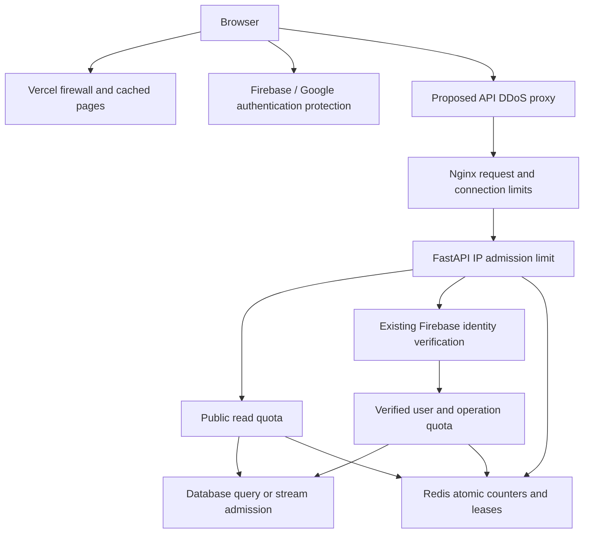

# Request abuse protection architecture

Proposed on October 12, 2026. Application and proxy implementation is now complete;
production activation and provider/hosting account changes remain pending. Scope
confirmed by the user: sign-in/sign-up, browser reloads, feed/filter requests, and
live-feed reconnects. The proposal below records the design intent; the implemented
contracts and rollout differences are recorded here and in `docs/deployment.md`.

Implemented: Redis server-time token buckets and expiring stream leases, ASGI
IP/global admission, verified-UID dependencies before private SQL, deadline-bound
limiter resources and diagnostics, safe rejection/CORS behavior, bounded companies/
stats caching, Nginx dry-run templates, browser cooldowns, duplicate action guards,
account-safe auth errors and filter-independent jittered sockets. Enforcement fails
closed with 503 for public reads too; no proxy-dependent fail-open has been enabled.
Reference data is cached; high-cardinality filtered jobs caching remains deferred.
Streams use provisional 20/IP and 200/global limits; HTTP concurrency is capped at
32 per worker. Existing single-worker fan-out is preserved. Public reads remain
anonymous; direct Firebase attempt protection and upstream traffic absorption need
the separate [account/edge rollout](authentication-and-edge-protection.md).

## Current boundaries

- Next.js pages run on Vercel. The browser calls the Oracle API directly through `NEXT_PUBLIC_API_URL`.
- `AuthModal` calls Firebase email/password and Google popup authentication directly. JobPing has no login endpoint that can enforce a custom login attempt quota.
- Oracle Nginx forwards requests to loopback Uvicorn. Its checked-in configuration has a 1 MB body limit, but no request or connection limiter. Public jobs, companies, stats, WebSocket and SSE routes are unauthenticated.
- Private notification and analytics routes use Firebase verification with revocation checking and an account lookup. Excess traffic must be rejected before these potentially expensive calls.
- `useLiveJobs` already aborts obsolete requests, guards concurrent pagination and uses bounded reconnect backoff. Filter changes recreate its socket, successful socket opens immediately reset retry backoff, and HTTP 429 responses currently become generic errors.
- The existing `DomainRateLimiter` controls outgoing scraper requests by waiting. Incoming API protection must reject excess traffic promptly and use separate policies/state.

## Recommended topology

The application limiter controls API consumption; an upstream DDoS service is required to absorb distributed traffic before it exhausts VM bandwidth. Vercel protects its own deployments, which does not put the separately hosted Oracle API behind that protection.

## Edge and proxy policy

Use Vercel's native firewall for page/navigation requests. Start custom reload limits in log mode, with a provisional ceiling of 60 navigation requests per minute per IP. Match actual navigation traffic, account for framework prefetch/data requests, and exclude assets so one page load does not consume a quota for every image, font and script. Verify the project's plan, rule allowance and billing before configuration. Vercel's published counters are regional, so this is an edge safeguard rather than a global account quota. See [Vercel rate limiting](https://vercel.com/docs/vercel-firewall/vercel-waf/rate-limiting) and [DDoS mitigation](https://vercel.com/docs/vercel-firewall/ddos-mitigation).

For `api.jobping.website`, propose a DDoS proxy such as Cloudflare with WebSocket/SSE compatibility. Verify existing DNS/proxy state first; local deployment documentation does not establish that state. Restrict the API origin to the proxy using a tunnel or appropriately scoped firewall/origin authentication. DNS proxying alone leaves a direct-origin bypass. Preserve other services on the shared VM and certificate renewal. See [origin protection](https://developers.cloudflare.com/fundamentals/security/protect-your-origin-server/).

Nginx applies coarse IP request limits, connection ceilings, ordinary HTTP timeouts and an aggregate admission ceiling sized by isolated load testing. Use separate locations for long-lived streams, retaining their heartbeat/upgrade behavior. Reject rather than accumulate a large delayed request queue. Observe first with `limit_req_dry_run`; explicitly return 429 for rate rejection. See [Nginx request limiting](https://nginx.org/en/docs/http/ngx_http_limit_req_module.html).

## Identity and Redis enforcement

Implement an injectable `RequestRateLimiter`, policy registry and pure ASGI admission middleware supporting HTTP and WebSocket scopes. Perform IP admission before body parsing, Firebase verification and database session creation. After existing identity verification, route dependencies enforce the verified UID quota before business work. Ensure dependency ordering is explicit; inserting a limiter after the current database dependency is insufficient.

Public browsing remains anonymous and initially uses IP quotas. Private routes use both a generous pre-verification IP ceiling and a tighter verified UID quota. Never obtain identity from an unverified token, browser-supplied user ID, email or arbitrary cookie. Ordinary Firebase token renewal is not a new interactive login attempt.

Use an atomic Redis Lua token bucket, Redis time, small expiring state and a fixed route-family registry. Return allowed/rejected and the calculated retry delay. Reuse the existing Redis service initially with a separately owned client/pool and short operation deadlines; keys use `jobping:ratelimit:v1:`. Do not alter ingestion keys or change the shared Redis eviction policy. Track memory and limiter latency; split into a dedicated limiter Redis instance if abuse affects ingestion resources. HMAC normalized IP/UID values with a server-only secret; do not include raw tokens, emails, queries or URLs in keys, logs or metrics. Counters are transient; no SQL migration is required.

Nginx must overwrite the forwarded client address after resolving only trusted upstream proxies. Uvicorn continues trusting loopback Nginx only. Test forged and multi-hop forwarding headers, direct requests, IPv4 and IPv6. Decide IPv6 subnet aggregation from observations rather than silently letting every rotated IPv6 address receive a fresh unrestricted budget. See [trusted real-IP configuration](https://nginx.org/en/docs/http/ngx_http_realip_module.html).

## Provisional quotas

These are starting hypotheses for observation, not established safe VM capacity. Token buckets allow the stated initial burst and then refill at the sustained rate.

| Family | Key | Sustained rate | Initial burst |
| --- | --- | --- | --- |
| Coarse API admission | Trusted client IP | 10 requests/second | 50 |
| Public jobs/companies/stats reads, shared across endpoints | IP | 120/minute | 20 |
| Private reads | Verified UID | 120/minute | 20 |
| Private settings/provider writes | Verified UID | 20/minute | 5 |
| Analytics events | Verified UID | 60/minute | 10 |
| WebSocket/SSE connection attempts, shared across protocols | IP | 20/minute | 5 |

Retain the existing five-minute notification test-email cooldown and delivery budgets. Webhooks get separate provider-appropriate ingress limits, signature verification and deduplication; they must not consume browser quotas or receive interactive challenges. Unsubscribe routes likewise have their own modest policy. Only narrowly identified internal health traffic bypasses limits; a public stats request, Origin header or user agent cannot claim an exemption. Preflight receives cheap edge protection without spending the browser's business-operation quota.

Public IP budgets may affect campus/shared networks. Observe those effects before enforcing; private per-user budgets distinguish signed-in users without eliminating aggregate protection. Set global API and stream capacity from load measurements, not the sum of per-user quotas.

## Login protection

Keep credentials within Firebase's supported client flows. Handle provider throttling with a friendly cooldown and generic authentication errors; allow one in-flight action and never automatically retry passwords or popup sign-ins. A browser timer or a JobPing preflight endpoint would be bypassable and cannot enforce a Firebase login quota.

Use Firebase's provider-side abuse limits as the baseline. For stronger email/password sign-in and sign-up protection, propose Identity Platform's reCAPTCHA integration, first in audit mode and then enforcement after client compatibility and false-positive review. Account configuration, availability and billable components need verification before rollout. This email/password protection must not be presented as Google OAuth protection; Google flows remain provider-managed. See [Firebase limits](https://firebase.google.com/docs/auth/limits) and [Identity Platform integration](https://docs.cloud.google.com/identity-platform/docs/recaptcha-enterprise).

If a later requirement demands exact JobPing-controlled login attempt quotas, design an enforced authentication flow separately, including prevention of direct Firebase bypass. Do not claim that moving an SDK call behind a nominal gateway achieves that. Avoid hard account-wide email lockouts that attackers could use to deny a victim access.

## Streams, caching and browser behavior

Connection-rate limits do not cap idle open streams. Reserve a shared expiring connection lease atomically before accepting a socket/opening an SSE subscription; renew active leases and release in `finally`. Include both protocols in one budget. Start observation around 20 concurrent streams per IP; measure a separate global ceiling. Lease renewal failures must have a bounded grace period followed by stream closure, so expired leases cannot leave uncounted connections alive. Cap inbound WebSocket frame size/message rate and bound slow-client send operations. Keep one API worker until the existing process-local event fan-out architecture is separately addressed.

Separate socket lifecycle from filter state, add reconnect jitter, and reset backoff after a stable connection interval rather than any brief successful open. Browser WebSocket handshakes do not expose HTTP retry headers to application code: use conservative backoff on failures, optionally a 1013 close with a bounded machine-readable delay for connections already accepted. Avoid accepting every connection just to report rejection. SSE reconnects require the same admission policy.

For HTTP 429, return a stable JSON error code and `Retry-After`; expose the header through CORS and apply allowed-origin CORS headers to Nginx rejections too. Prevent caching rejection responses. The UI keeps existing jobs, displays the wait, and suspends retries/actions until the deadline. Never interpret a throttled or failed response as an empty successful feed. Coalesce identical requests and retain the existing debounce. Cache public companies/stats briefly (initially 30-60 seconds); consider a bounded 5-10 second public jobs cache keyed by all normalized validated filters. Never publicly cache authenticated responses. Cache misses still consume quotas; caching is not enforcement.

## Failure policy, validation and rollout

On limiter Redis failure, public HTTP reads may proceed only under enforced Nginx aggregate limits and bounded database concurrency; return temporary 503 when those guards are unavailable. Private operations and new stream admission return 503, not a false 429. Existing leases follow the bounded renewal grace above. Do not silently substitute unlimited or per-process-only counters. Retain existing Firebase revocation/account checks.

Instrument allowed/rejected/shadow-rejected counts by fixed policy, active streams, limiter errors and latency, plus API/database saturation. Do not use client identifiers as metric labels or put IP data in analytics events. Roll out with short-retention operational diagnostics and an explicit policy flag for rollback.

1. Add network-free deterministic tests for burst/refill/expiry, concurrency, policy grouping, trusted headers, dependency ordering, Redis outages, CORS and rejection responses. Add isolated Redis atomicity tests and lease cleanup/cancellation/crash recovery coverage.
2. Add frontend tests for login throttling, no automatic credential retries, HTTP cooldown/data retention, and jittered reconnects independent of filter changes. Run repository-required backend and frontend checks before handoff.
3. Validate edge and proxy rules against reloads, rapid filters, pagination, multiple tabs, shared-network users, internal checks, signed webhooks and SSE/WebSocket behavior. Use isolated load testing to set global ceilings.
4. Deploy shadow/log mode and collect representative traffic; review false positives and resource headroom. Confirm provider account configuration, plan allowances and costs.
5. Enforce by family, observe errors/rejections and retain rollback flags. Upstream DDoS/origin protection is a separate operational rollout; application limits alone do not complete that protection.
